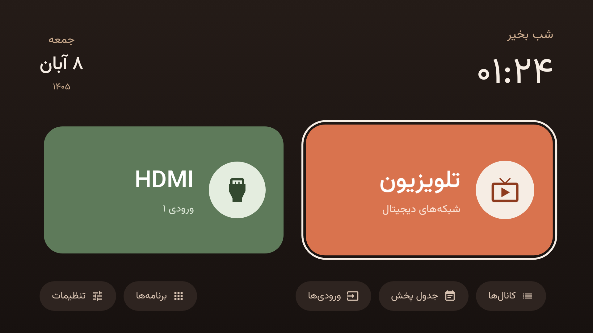
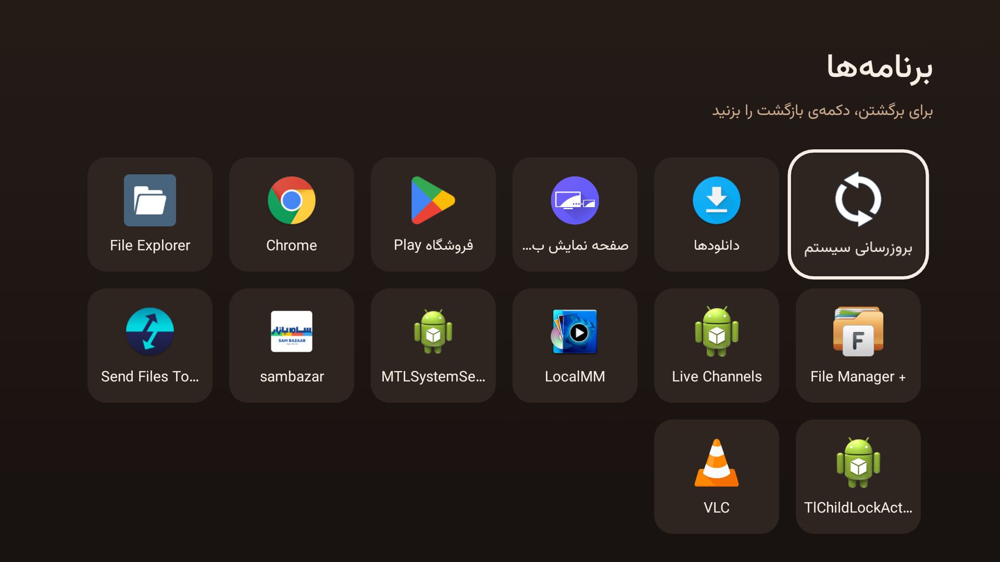

# SAM Home · خانه ساده

A calm, warm home screen for old SAM TVs (Iranian brand, MStar chipset, Android 6), made for
people who mostly watch antenna TV and one HDMI device. Inspired by
[tv-detox](https://github.com/Ansub/tv-detox), which doesn't fit these TVs (see below).

صفحه‌ی خانه‌ای ساده و گرم برای تلویزیون‌های قدیمی سام (پردازنده‌ی MStar، اندروید ۶)، برای کسانی که
بیشتر آنتن و یک دستگاه HDMI تماشا می‌کنند.



## What it does

- Two big cards: **digital antenna TV** and **HDMI 1**, one press each. It remembers which one
  was used last and focuses it.
- Clock, a greeting for the time of day, and the **Jalali (Solar Hijri) date**.
- A small row for the channel list, programme guide, the TV's own input menu, apps and settings.
- Apps live in a separate panel, out of the way.
- Opens by itself when the TV turns on, and the remote's **Home** key opens it instead of the
  TV's own launcher bar.
- About 165 KB (most of it the Vazirmatn font) and about 22 MB of RAM. No images, no libraries.



## Why not tv-detox

These TVs don't fit the usual Android TV approach:

- There is no Android `tv_input` service. Antenna and HDMI live inside MStar's own player
  (`com.mstar.tv.tvplayer.ui`), and so does the stock home screen, so it can't be turned off.
- Inputs are switched with the player's own intent, the one its Source menu sends:
  `com.mstar.android.intent.action.START_TV_PLAYER` with `inputSrc` (MStar `EnumInputSource`:
  `28` DTV, `1` ATV, `23`/`24`/`25` HDMI 1–3).
- The Home key is taken over with a small accessibility service (`HomeKeyService`) instead of
  replacing the system home app.

## Build

Needs Java and the Android SDK (any recent `platforms` and `build-tools`). No Gradle.

```sh
sh build.sh
```

This makes `out/samhome.apk` and, on the first build, a signing key `key.jks`. Keep that key:
updates must be signed with it.

## Install

Turn on USB debugging on the TV (Settings → About → press Build 7 times, then Developer options),
then from a computer on the same network:

```sh
adb connect <TV_IP>:5555
adb install -r out/samhome.apk
adb shell am start -n ir.samhome/.MainActivity
# Make the remote's Home key open it:
adb shell settings put secure enabled_accessibility_services ir.samhome/ir.samhome.HomeKeyService
adb shell settings put secure accessibility_enabled 1
```

Turn USB debugging off again when you're done.

## Undo

Turn off the Home key service in Settings → Accessibility, or:

```sh
adb shell settings put secure enabled_accessibility_services null
adb uninstall ir.samhome
```

## Tested on

SAM TV, `aosp_almond_dtmb`, MStar "Mooney", Android 6.0, firmware `TVOS-04.19`. Other MStar TVs
may use different input numbers or intents.

## License

MIT. The bundled [Vazirmatn](https://github.com/rastikerdar/vazirmatn) font is under the SIL
Open Font License 1.1.
